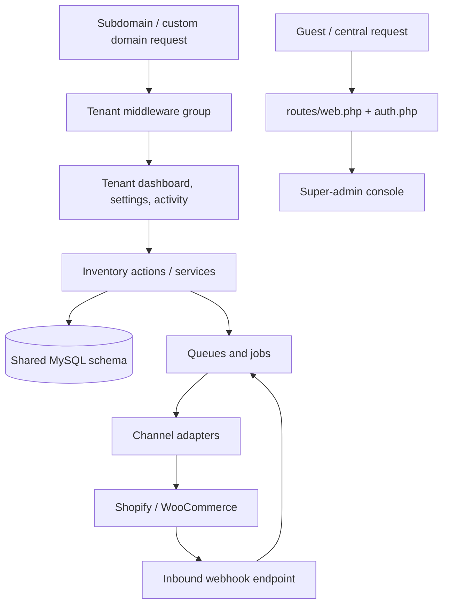

# Architecture

This document describes the existing architecture of Inventra Sync and the logical boundaries the inventory product must follow. It complements [`PRD.md`](../PRD.md) and [`DEVELOPMENT_PLAN.md`](../DEVELOPMENT_PLAN.md).

## 1. System shape

Inventra Sync is a single Laravel application with three HTTP surfaces sharing one database schema.

| Surface | Route file | Domain | Primary users |
| --- | --- | --- | --- |
| Central app | `routes/web.php`, `routes/auth.php` | `APP_URL` host plus `localhost` and `127.0.0.1` | Guests and central users |
| Tenant app | `routes/tenant.php` | Tenant subdomain or custom domain | Organization members |
| Central admin | `routes/web.php` under `admin/` | Central domain | Super admins |

Tenant identification uses `stancl/tenancy` domains. The tenant is resolved from the request host, never from a user-supplied ID. `tenant()` is the runtime context object used by tenant code.



## 2. Verified baseline

| Concern | Current implementation |
| --- | --- |
| Framework | Laravel 13 (`^13.17`), PHP `^8.3` (running 8.4) |
| Authentication | Laravel Breeze Blade stack |
| Tenancy | `stancl/tenancy` 3, single database, `tenants` + `domains` + `users.tenant_id` |
| Authorization | `spatie/laravel-permission` 8, teams enabled with `tenant_id` as team key |
| Auditing | `spatie/laravel-activitylog` 5 |
| Frontend | Blade, Alpine.js, Tailwind CSS 3 tokens, Vite 8 |
| Tests | Pest 5 |
| Queue | `QUEUE_CONNECTION=database` locally; Redis is the production recommendation |
| Configuration | `APP_NAME` from `.env`; UI reads `config('app.name')` |

The source of truth for visual tokens and UI shells is [`design.md`](../design.md), specifically `tailwind.config.js`, `resources/css/app.css`, and the Blade components under `resources/views/components/`. Older files under `design-system/orbit/` are historical references where they conflict.

## 3. Request lifecycle

### 3.1 Central requests

`routes/web.php` registers routes against each configured central domain. Authentication, email verification, profile, dashboard, activity, and super-admin routes live here. The canonical domain is taken from `config('tenancy.central_domains')[0]` so named routes generate stable URLs.

### 3.2 Tenant requests

`routes/tenant.php` wraps all tenant routes in:

1. `web`
2. `PreventAccessFromCentralDomains`
3. `InitializeTenancyByDomainOrSubdomain`
4. `EnsureTenantIsActive`

`EnsureTenantIsActive` runs before authentication so suspended workspaces receive a consistent response. Authenticated routes then apply `auth`, and individual routes apply `permission:<name>` middleware where needed.

Tenant settings routes are grouped under `/settings` with names such as `settings.workspace.edit`, `settings.roles.index`, and `settings.members.index`. New inventory routes should follow this style: tenant-only route file, explicit permission middleware, and named routes.

### 3.3 Tenant context and background work

The application uses one physical database. `config/tenancy.php` enables cache, filesystem, and queue bootstrappers but no database connection switch. This means:

- All tenant-owned rows must carry `tenant_id`.
- Every query must be scoped to the active tenant.
- Every record ID passed from the request must be authorized against the active tenant.
- Queued jobs must carry tenant context explicitly; `QueueTenancyBootstrapper` restores it, but jobs must still validate their tenant before mutating data.
- Webhook routes must resolve the tenant from a trusted mapping (connection, domain, or signed credential) before processing events.

## 4. Identity, tenancy, and authorization

### 4.1 Tenant model

`App\Models\Tenant` extends the Stancl tenant model with `HasDomains`, a virtual `status` value stored in `data`, active/suspended scopes, subdomain/custom-domain helpers, and `preferredHost()`.

`App\Models\User` uses `BelongsToTenant` and `HasRoles`. Each user belongs to one tenant; `is_super_admin` is reserved for central administration.

### 4.2 Roles and permissions

`config/permission.php` enables Spatie teams with `team_foreign_key = tenant_id`. Roles and role assignments are scoped with `App\Models\Scopes\TenantRoleScope`.

Tenancy events wire the permission context:

- `TenantCreated` → `SeedTenantPermissions` creates permissions and the protected `Admin` role for that tenant.
- `TenancyBootstrapped` → `UseTenantPermissionCache` switches to the tenant permission context.
- `TenancyEnded` → `UseCentralPermissionCache` returns to the central context.

New inventory permissions belong in `PermissionSeeder::GROUPS`. Do not create a second RBAC system. Add permission checks to routes and policies using existing middleware and `can()` conventions.

### 4.3 Activity logging

`spatie/laravel-activitylog` records authentication and role/member changes in `activity_log`. Tenant views scope activity through causer membership in the active tenant. Inventory stock movements must use a dedicated immutable ledger; activity records are for user-facing business audit, not quantity arithmetic.

## 5. Inventory product boundaries

The starter kit owns authentication, tenancy, organizations/workspaces, memberships, RBAC, settings, and activity logging. The inventory product adds these logical modules without duplicating that foundation:

| Module | Responsibility |
| --- | --- |
| Organization integration | Apply tenant context and permissions to all inventory operations |
| Product catalog | Products, variants, SKUs, barcodes, categories, images, import/export |
| Warehouse management | One default warehouse per tenant in MVP, extensible to many |
| Inventory engine | On-hand, reserved, available, adjustments, ledger |
| Reservation | Reserve, release, commit, expire; prevent overselling |
| Channel integration | Connections, encrypted credentials, adapters, listings, mappings, buffers |
| Order management | Imported orders, snapshots, idempotency, statuses |
| Fulfilment and returns | Commit/release stock, shipment details, cancellations, returns |
| Synchronization | Outbox, jobs, retries, webhook events, sync logs, reconciliation |
| Reporting | Stock health, movement, order, failure, and connection reports |

### 5.1 Layering

Use the existing Laravel structure rather than introducing a new top-level namespace without approval.

```text
routes/tenant.php or routes/api.php
  -> app/Http/Controllers/<Domain>/...
  -> app/Http/Requests/<Domain>/...
  -> app/Policies/... and permission middleware
  -> app/Actions or app/Services (transactional business operations)
  -> app/Models/...
  -> database migrations
```

Cross-cutting pieces:

- `app/Events/` for domain notifications after commit or via the outbox.
- `app/Listeners/` for secondary reactions.
- `app/Jobs/` for queued work.
- `app/Contracts/` and `app/Adapters/` for provider integrations.
- Repositories only if the existing codebase justifies them.

Transactional inventory operations belong in actions/services, not controllers or views. Controllers should validate through Form Requests, authorize, call one action, and return a response.

## 6. Data integrity and concurrency rules

- Every business table carries `tenant_id` and a foreign key to `tenants` where practical.
- SKUs are unique within a tenant.
- Stock is unique for `(tenant_id, warehouse_id, product_variant_id)`.
- External order IDs are unique per channel connection.
- Webhook and outbox events have stable deduplication keys.
- Stock/reservation updates run in a single `DB::transaction()` with `lockForUpdate()` on stock rows.
- Every stock movement writes an immutable ledger row in the same transaction.
- Idempotency keys make retried jobs and duplicate webhooks safe.
- Historical order items preserve product, SKU, title, and price snapshots.
- Prefer archive/status transitions over hard deletes for referenced business records.

## 7. Integration architecture

Core inventory code must not contain Shopify or WooCommerce API calls. Put provider behavior behind a common adapter contract with operations such as credential validation, listing import, inventory push, order fetch, and fulfilment push.

Outbound synchronization follows the transactional outbox pattern:

1. A stock transaction writes the outbox event in the same database transaction.
2. A dispatcher job reads pending events in order.
3. The adapter pushes stock to mapped listings.
4. Success, retry, and permanent failure states are recorded.
5. Event sequence/version prevents stale updates from overwriting newer quantities.

Inbound webhooks follow the fast-acknowledge pattern:

1. Verify provider signature.
2. Persist the raw event with a deduplication key.
3. Acknowledge quickly.
4. Dispatch processing to a queue.
5. Process business changes transactionally.
6. Emit outbound sync events through the outbox.

Credentials are encrypted at rest with Laravel `Crypt`, excluded from serialization/logs, and never returned to unauthorized users.

## 8. Frontend architecture

- Use `<x-app-layout>` for tenant pages and `<x-settings-layout>` for settings pages.
- Use central admin components for super-admin screens.
- Reuse `glass-card`, `btn-primary`, `field-input`, `<x-icon>`, tables, and badge patterns from `design.md`.
- Gate navigation links and page data by the same permissions used on routes.
- All user-facing branding reads `config('app.name')`.
- Do not add fake KPI values; dashboard metrics must come from scoped, permission-checked data.

## 9. Documentation map

| Document | Purpose |
| --- | --- |
| [`PRD.md`](../PRD.md) | Product requirements, roles, modules, acceptance criteria |
| [`DEVELOPMENT_PLAN.md`](../DEVELOPMENT_PLAN.md) | Ordered milestones and per-phase exit criteria |
| [`audit.md`](audit.md) | Verified baseline, reusable components, gap analysis, and start gate |
| [`architecture.md`](architecture.md) | This document: runtime and code boundaries |
| [`database.md`](database.md) | Current schema, planned schema, constraints, migrations |
| [`implementation.md`](implementation.md) | How to build each milestone |
| [`testing.md`](testing.md) | Test strategy, commands, and required regression coverage |
